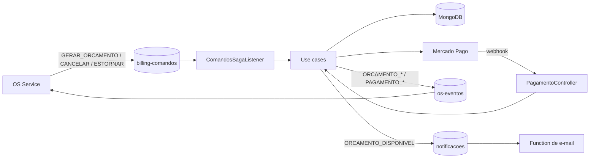

# Oficina — Billing Service

Microsserviço de **orçamento e pagamento** da oficina mecânica (Tech Challenge SOAT — Fase 4).
Gera o orçamento de cada OS, envia para o cliente aprovar, cobra pelo **Mercado Pago** e avisa o
OS Service do resultado. Participa da saga da ordem de serviço orquestrada pelo
[OS Service](https://github.com/robsonago/oficina).

| | |
|---|---|
| Linguagem | Java 21 / Spring Boot 3.4 |
| Banco | **MongoDB** (NoSQL) — um orçamento é um documento: itens, cobrança e histórico juntos |
| Mensageria | Google Pub/Sub (comandos da saga entram, eventos saem) |
| Pagamento | Mercado Pago Checkout Pro (preferência + webhook + estorno) |
| Observabilidade | New Relic APM + distributed tracing, métricas Micrometer, logs JSON com `correlationId`/`sagaId` |

## Índice

1. [Responsabilidades](#1-responsabilidades)
2. [Arquitetura do serviço](#2-arquitetura-do-serviço)
3. [Papel na saga](#3-papel-na-saga)
4. [Mercado Pago](#4-mercado-pago)
5. [API](#5-api)
6. [Como executar](#6-como-executar)
7. [Testes e cobertura](#7-testes-e-cobertura)
8. [CI/CD](#8-cicd)
9. [Kubernetes](#9-kubernetes)

## 1. Responsabilidades

- Gerar o orçamento a partir dos serviços e peças da OS (comando `GERAR_ORCAMENTO`).
- Enviar o orçamento para aprovação (notificação por e-mail via tópico de notificações da Fase 3).
- Registrar a decisão do cliente; na aprovação, criar a cobrança no Mercado Pago e devolver o link de pagamento.
- Receber o webhook do Mercado Pago, **consultar o pagamento na API** e avisar o OS Service (`PAGAMENTO_APROVADO`/`PAGAMENTO_RECUSADO`).
- Executar as compensações pedidas pela saga: cancelar o orçamento ou **estornar o pagamento**.

O Billing não acessa o banco de nenhum outro serviço: tudo o que precisa da OS (cliente, itens, preços)
chega no próprio comando `GERAR_ORCAMENTO`.

## 2. Arquitetura do serviço

Arquitetura hexagonal, igual à do OS Service:

```
src/main/java/br/com/fiap/challange/billing/
├── domain/
│   ├── model/          Orcamento (regras de transição), Pagamento, ItemOrcamento, TiposMensagem
│   ├── port/in/        OrcamentoInputPort, PagamentoInputPort
│   └── port/out/       OrcamentoRepositoryPort, GatewayPagamentoPort, EventosSagaPort, NotificacaoPort
├── application/usecase/ OrcamentoUseCase, PagamentoUseCase
└── infrastructure/
    ├── adapter/in/rest/        OrcamentoController, PagamentoController (webhook + simulação)
    ├── adapter/in/messaging/   ComandosSagaListener (idempotente pelo id da mensagem)
    ├── adapter/out/persistence MongoDB (OrcamentoDocument com @Version)
    ├── adapter/out/pagamento   MercadoPagoAdapter | PagamentoSimuladoAdapter
    ├── adapter/out/mensageria  EventosSagaAdapter
    └── messaging/              Pub/Sub (publicação, assinatura, propagação de trace)
```



## 3. Papel na saga

A saga é **orquestrada** pelo OS Service (decisão e justificativa no
[README do OS Service](https://github.com/robsonago/oficina#saga-pattern)). O Billing só responde aos comandos:

| Comando recebido | O que faz | Evento devolvido |
|---|---|---|
| `GERAR_ORCAMENTO` | cria o orçamento e notifica o cliente | `ORCAMENTO_GERADO` (ou `ORCAMENTO_FALHOU`) |
| — (cliente decide via API) | aprova → cria cobrança no Mercado Pago | `ORCAMENTO_APROVADO` / `ORCAMENTO_REJEITADO` |
| — (webhook do Mercado Pago) | consulta o pagamento | `PAGAMENTO_APROVADO` / `PAGAMENTO_RECUSADO` |
| `CANCELAR_ORCAMENTO` | compensação: cancela o orçamento | `ORCAMENTO_CANCELADO` |
| `ESTORNAR_PAGAMENTO` | compensação: estorno total no Mercado Pago | `PAGAMENTO_ESTORNADO` |

Garantias: comandos repetidos não duplicam nada (controle pelo id da mensagem + checagem do estado do
orçamento); exceção no processamento devolve a mensagem para a fila (*nack*) e, depois de 5 tentativas,
ela vai para a dead letter `oficina-saga-dlq-<ambiente>`.

## 4. Mercado Pago

Integração com o [Checkout Pro](https://www.mercadopago.com.br/developers/pt/docs/checkout-pro/landing):

1. **Aprovação** → `POST /checkout/preferences` com os itens do orçamento, `external_reference` = id do
   orçamento e `notification_url` apontando para o webhook. O link (`init_point`/`sandbox_init_point`)
   volta para o cliente.
2. **Webhook** → `POST /api/pagamentos/webhook`. A notificação só traz o id do pagamento; o serviço
   valida a assinatura `x-signature` (HMAC-SHA256 com a chave secreta do painel) e consulta
   `GET /v1/payments/{id}` para saber o status real.
3. **Compensação** → `POST /v1/payments/{id}/refunds` (estorno total, com `X-Idempotency-Key`).

| Variável | Uso |
|---|---|
| `PAGAMENTO_PROVIDER` | `mercadopago` ou `simulado` (padrão) |
| `MERCADOPAGO_ACCESS_TOKEN` | access token da aplicação (em teste começa com `TEST-`) |
| `MERCADOPAGO_WEBHOOK_SECRET` | chave secreta do webhook (assinatura) |
| `MERCADOPAGO_NOTIFICATION_URL` | URL pública do webhook (no GCP, a do API Gateway) |
| `MERCADOPAGO_SANDBOX` | `true` usa o `sandbox_init_point` |

**Modo simulado**: sem credencial, o link de pagamento aponta para
`POST /api/pagamentos/simulacao/{orcamentoId}` com `{"aprovado": true|false}`, que faz o papel do
webhook — útil para demonstrar o caminho feliz e a compensação sem depender de cartão de teste.

## 5. API

Swagger: `/billing/swagger-ui.html` (local: http://localhost:8081/billing/swagger-ui.html).
Todas as rotas exigem o JWT emitido pelo OS Service (funcionário) ou pela function de CPF (cliente),
exceto o webhook. Um cliente só enxerga e decide os próprios orçamentos.

| Método | Rota | Descrição |
|---|---|---|
| GET | `/api/orcamentos/{id}` | orçamento com itens, cobrança e histórico |
| GET | `/api/orcamentos/ordem-servico/{osId}` | orçamentos de uma OS |
| POST | `/api/orcamentos/{id}/aprovacao` | `{"aprovado": true, "observacao": "..."}` |
| POST | `/api/pagamentos/webhook` | notificação do Mercado Pago (pública) |
| POST | `/api/pagamentos/simulacao/{orcamentoId}` | simula o pagamento (modo simulado) |

## 6. Como executar

Sozinho (sem broker, mensagens ficam em memória):

```bash
docker run -d -p 27017:27017 mongo:7.0
./mvnw spring-boot:run
```

Com os três serviços e o emulador do Pub/Sub, use o `docker-compose.yml` do repositório
[`oficina`](https://github.com/robsonago/oficina#como-executar) (clone os três repositórios lado a lado).

## 7. Testes e cobertura

```bash
./mvnw verify    # unitários + integração (MongoDB e emulador do Pub/Sub via Testcontainers) + JaCoCo
```

- Testes unitários do domínio, casos de uso e adaptadores (Mercado Pago com `MockRestServiceServer`).
- Integração com **MongoDB real** (Testcontainers) cobrindo o fluxo completo: gerar → aprovar → pagar →
  estornar, recusa de pagamento, rejeição e regras de acesso.
- Os adaptadores de Pub/Sub rodam contra o **emulador oficial do Google** (publicação com atributos,
  consumo, *nack* e reentrega).
- O build falha se a cobertura de linhas ficar abaixo de **80%** (regra do JaCoCo no `pom.xml`).

Cobertura atual: **96%** de linhas — relatório em `target/site/jacoco/index.html` e no resumo de cada
execução do GitHub Actions; análise contínua no SonarCloud (`robsonago_oficina-billing-service`).

## 8. CI/CD

[`.github/workflows/ci-cd.yml`](.github/workflows/ci-cd.yml), independente dos outros serviços:

1. **Build e Testes** — `./mvnw verify` (inclui a regra de 80%); publica relatórios.
2. **Qualidade (SonarCloud)** — análise com Quality Gate (precisa do secret `SONAR_TOKEN`).
3. **Imagem Docker** — `ghcr.io/robsonago/oficina-billing-service:<sha>` (push em `homolog`/`main`).
4. **Deploy no GKE** — aplica `k8s/overlays/<ambiente>` com a imagem do commit e espera o rollout
   (`homolog` → `oficina-homolog`, `main` → `oficina-producao`; ligado pela variável
   `GKE_DEPLOY_ENABLED=true`).

A branch `main` é protegida: só entra por Pull Request com os checks *Build e Testes* e
*Qualidade (SonarCloud)* passando.

## 9. Kubernetes

```
k8s/
├── base/          Deployment, Service, HPA (1–3 réplicas, 70% CPU) e MongoDB (StatefulSet + PVC)
└── overlays/      homolog | producao (namespace)
```

ConfigMap/Secret (`oficina-billing-config`, `oficina-billing-secret`, `oficina-billing-mongodb`), a
service account com Workload Identity e as permissões no Pub/Sub são criados pelo Terraform em
[`oficina-infra-k8s`](https://github.com/robsonago/oficina-infra-k8s).
